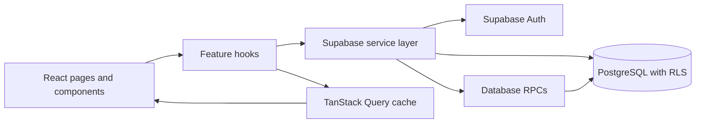

# FormFlow


**Build forms, publish shareable links, and review responses in one workspace.**
FormFlow is a full-stack form builder built with React, Supabase, and PostgreSQL.
It includes a drag-and-drop editor with a live preview, public form submissions,
and a searchable, paginated response dashboard.

**Live demo:** [form-flow-fawn.vercel.app](https://form-flow-fawn.vercel.app/)

## Features

- **Authentication and private workspaces** — sign up and sign in with Supabase
  Auth; each account manages its own forms.
- **Form dashboard** — create and delete forms, search by title, filter drafts
  and published forms, and review workspace totals.
- **Visual form builder** — add, edit, remove, and reorder short-text, long-text,
  and multiple-choice questions; mark questions as required and configure
  choice options.
- **Live preview and local drafts** — preview changes as you edit; unsaved
  changes are kept in browser storage and restored in the same user's workspace.
- **Draft and publish workflow** — save a draft with or without questions,
  publish only after adding at least one question, reuse the same public link
  when republishing, and unpublish a live form.
- **Public forms** — collect anonymous submissions with client-side feedback
  and server-side validation.
- **Response dashboard** — browse responses 20 at a time, search across answer
  text and question labels, and export all responses as CSV.
- **Safer CSV exports** — escape CSV syntax and neutralize spreadsheet formula
  prefixes in exported values.
- **Responsive interface** — layouts adapt across the public form, builder,
  dashboard, and response views.

## Tech stack

| Area | Technologies |
| --- | --- |
| UI | React 19, JavaScript, Tailwind CSS 4, Lucide, Framer Motion |
| Forms and navigation | React Hook Form, React Router 6 |
| Server state | TanStack Query |
| Backend | Supabase Auth, PostgreSQL, Row Level Security, PostgREST RPC |
| Build and tests | Vite, Vitest, React Testing Library, ESLint |
| Hosting | Vercel |

## How it works



The UI uses feature hooks to coordinate form state and server state. Data access
is handled by the Supabase service layer, with React Hook Form for builder and
authentication forms and TanStack Query for fetching, caching, and
invalidating server data.

## Security

- Row Level Security is enabled for forms, fields, and responses. Authenticated
  users can manage their own data; anonymous visitors can read only the
  public-safe columns and fields of published forms.
- Public submissions go through the `submit_form_response` PostgreSQL RPC.
  Direct response inserts are restricted by migration `0003`; the RPC checks
  that the form is published, validates required answers and field types,
  limits payload size, and accepts only configured multiple-choice options.
- Form saves use the authenticated `save_form_draft` RPC. It checks ownership
  and saves the title and question list in a single transaction while
  preserving the existing RLS policies.
- Response pagination and search run through the authenticated
  `get_form_responses_page` RPC, which also remains subject to RLS.
- The browser uses only the Supabase project URL and public anon key. Never put
  a Supabase service-role key or other server secret in a `VITE_` variable.

## Getting started

### Prerequisites

- Node.js 24 (the repository pins the major version in `.nvmrc`)
- pnpm 10
- A Supabase project

### Install and run

```bash
git clone https://github.com/Ali-jalili/FormFlow.git
cd FormFlow
nvm use
pnpm install --frozen-lockfile
```

Create a root-level `.env` file using `.env.example`:

```env
VITE_SUPABASE_URL=https://your-project.supabase.co
VITE_SUPABASE_ANON_KEY=your-public-anon-key
```

Apply the Supabase migrations described below, then start the development
server:

```bash
pnpm dev
```

Vite prints the local URL when the server is ready.

## Supabase setup

Run the SQL files in `supabase/migrations/` **in numerical order**, from
`0001_initial_schema.sql` through `0009_required_whitespace_validation.sql`,
using the Supabase Dashboard SQL Editor or your usual migration workflow.

Migrations `0007` and `0008` are required for the current form-save and
response-browsing implementations. Migration `0009` updates server-side
required-answer validation. For an existing database, apply only migrations
that have not already been applied, keeping the same order. After applying a
function migration, refresh the PostgREST schema cache if the new RPC is not
recognized:

```sql
NOTIFY pgrst, 'reload schema';
```

See [`supabase/README.md`](./supabase/README.md) for the migration list,
application details, and database security model.

## Available scripts

| Command | Description |
| --- | --- |
| `pnpm dev` | Start the Vite development server. |
| `pnpm build` | Create the production build in `dist/`. |
| `pnpm preview` | Preview the production build locally. |
| `pnpm test` | Run the Vitest suite once. |
| `pnpm test:watch` | Run Vitest in watch mode. |
| `pnpm lint` | Run ESLint. |

## Tests and CI

The test suite uses Vitest, jsdom, and React Testing Library. It covers form
builder interactions, public-form validation and submission, response search
and pagination contracts, CSV escaping, form-save behavior, and form utilities.
Database calls are mocked in automated tests; use a configured Supabase project
to verify migrations and live database behavior.

GitHub Actions runs dependency installation, lint, production build, and tests
for pushes and pull requests targeting `main` and `develop`. CI uses Node.js 24
and pnpm 10.

## Project structure

```text
src/
  app/                 Application shell, routes, and protected routes
  components/          Shared layout and UI components
  features/
    Auth/              Supabase authentication context and hook
    form/
      components/      Builder, preview, public form, and dashboard components
      hooks/           Form, response, and submission workflows
      services/        Supabase data access
      utils/           Field constants, builder helpers, and CSV utilities
  lib/                 Supabase client
  pages/               Home, auth, dashboard, builder, public, and response pages
supabase/
  migrations/          PostgreSQL schema, policies, and RPC functions
```

## Current scope and limitations

- **Published forms use live definitions.** The current client does not read or
  write a frozen publish snapshot. Editing and saving a published form changes
  the questions respondents see. Migration `0005` adds a `published_snapshot`
  column as groundwork only; snapshot behavior is not implemented.
- **Response views use current questions.** The response page and CSV export
  map stored answers using the form's current field definitions. Answers for
  questions later removed from a form are not presented as current questions.
- **The response page is paginated, but CSV export fetches every response.**
  Exporting very large forms can take longer and use more browser memory.
- The builder currently supports short text, long text, and multiple choice.
  Conditional logic, file uploads, templates, and per-question analytics are
  outside the current feature set.

## Deployment

The project is configured for Vercel as a single-page application. Set
`VITE_SUPABASE_URL` and `VITE_SUPABASE_ANON_KEY` in the deployment environment,
apply the required Supabase migrations, and deploy the repository. `vercel.json`
rewrites application routes to `index.html` and enables long-lived caching for
hashed assets.

## Author

**Ali Jalili**

- [GitHub](https://github.com/Ali-jalili)
- [LinkedIn](https://linkedin.com/in/ali--jalili)
